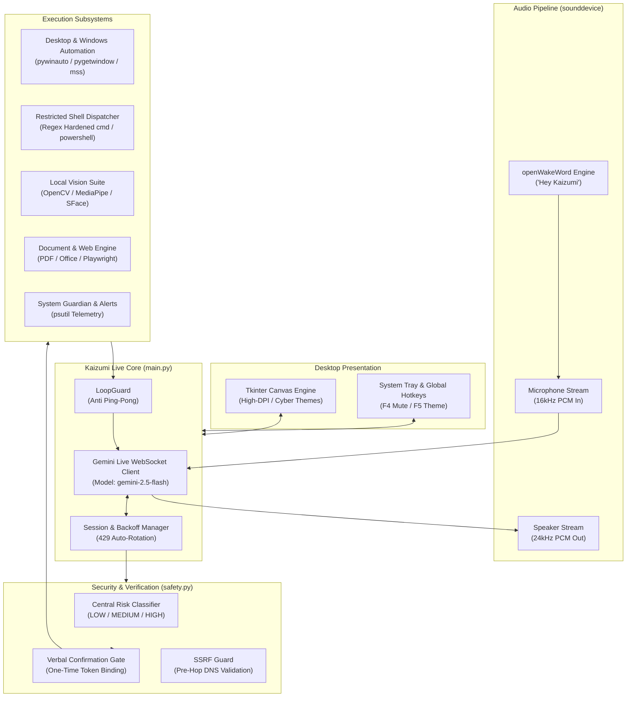

<p align="center">
  
</p>

<p align="center">
  <b>Real-Time, Voice-Driven Multimodal AI Companion for Windows</b><br>
  <i>Sub-second speech-to-speech interaction, desktop vision, autonomous tooling, and hardened local automation.</i>
</p>

<p align="center">
  <a href="https://github.com/MusayevDoniyor/kaizumi/actions/workflows/ci.yml"></a>
  <a href="https://www.python.org/"></a>
  <a href="https://opensource.org/licenses/MIT"></a>
  <a href="https://www.microsoft.com/windows"></a>
  <a href="https://ai.google.dev/"></a>
</p>

<p align="center">
  <a href="#-project-overview">Overview</a> •
  <a href="#-system-architecture">Architecture</a> •
  <a href="#-features--tooling">Features & Tools</a> •
  <a href="#-quick-start">Quick Start</a> •
  <a href="#-security--safety-model">Security Model</a> •
  <a href="#-configuration">Configuration</a> •
  <a href="#-telegram-remote-control">Telegram Remote</a> •
  <a href="#-testing--verification">Testing</a> •
  <a href="#-roadmap">Roadmap</a> •
  <a href="#-contributing">Contributing</a>
</p>

---

## 💡 Project Overview

**Kaizumi** is an open-source, on-device AI companion built for Windows 10 and 11. Unlike traditional text-based chatbots or turn-by-turn speech wrappers, Kaizumi connects directly to Google's **Gemini Live API** via bidirectional WebSocket audio streaming (PCM 24kHz/16kHz), delivering natural, conversational speech with human-level latency and real-time interruption (barge-in) support.

Equipped with screen awareness, local computer vision, persistent episodic memory, and a hardened system dispatch engine, Kaizumi can monitor system metrics, manage windows and files, write and run automation scripts, conduct research, control smart home devices, and guard user privacy—all while maintaining an animated cyber-themed desktop UI.

### Who Is Kaizumi For?
- **Developers & Power Users:** Seeking a customizable, local-first alternative to proprietary desktop assistants.
- **AI & Systems Researchers:** Exploring practical real-time multimodal tool use, human-in-the-loop safety gates, and low-latency audio pipelines.
- **Open-Source Enthusiasts:** Looking for a clean, extensible codebase with zero telemetry, zero forced subscriptions, and full self-hosting control.

> 👥 **Authors & Collaborators:**  
> - **Doniyor Musayev (Kaizo)** ([@MusayevDoniyor](https://github.com/MusayevDoniyor)) — Lead author & maintainer  
> - **Otabek Abduvaliyev** ([@OtabekAbduvaliyev](https://github.com/OtabekAbduvaliyev)) — Collaborator & contributor  
> 📜 **License:** [MIT Open Source License](LICENSE)

---

## 🏗️ System Architecture

Kaizumi operates on a decoupled, asynchronous event loop powered by Python `asyncio`. Audio input and output streams run independently from the UI loop and background watchdog tasks, guaranteeing that hardware disconnections, high tool latency, or network hiccups never freeze the application.



---

## ✨ Features & Tooling

Kaizumi exposes **53 declarative tool definitions** to the model. Each tool is executed with hard timeouts, error recovery, and risk boundary checks.

| Category | Capabilities & Implemented Tools | Local vs. Cloud |
| :--- | :--- | :--- |
| 🎙️ **Real-Time Voice** | Bidirectional live speech streaming, low-latency turn-taking, barge-in support, 30+ customizable Gemini voices, wake-word listener (`actions/wake_word.py`). | Cloud LLM + Local Audio |
| 🖥️ **Windows Automation** | Window management, app launching, typing, mouse control, file organization, media playback, system settings (volume/brightness/lock). | 100% Local |
| 🔒 **Safety & Risk Gate** | Centralized risk evaluation (`safety.py`). Destructive actions require explicit verbal consent bound to a single-use token (`confirm_token`). | 100% Local |
| 👁️ **Visual Awareness** | Screen capture understanding, active window inspection, webcam vision, privacy face blur, gesture recognition, and local arcade games. | Local CV + Cloud VLM |
| 🧠 **Persistent Memory** | Episodic memory (`memory/memory.py`) extracting preferences, user details, and plans across restarts with TTL expiration and automatic secret redaction. | 100% Local |
| 🛡️ **Guardian Telemetry** | Background watchdog monitoring battery level, RAM consumption, CPU spikes, disk space, and temperatures with spoken alerts. | 100% Local |
| 📄 **Document & Web QA** | Instant question-answering over PDF, DOCX, PPTX, XLSX, and web pages with SSRF-protected HTTP fetching. | Local parsing + Cloud QA |
| 🌐 **Headless Browser** | Automated Chromium browsing via Playwright (`actions/browser_control.py`) for live web navigation, clicking, typing, and scraping. | Local Browser |
| 💬 **Telegram Control** | Secure remote control from any Telegram chat (`telegram_bot.py`). Supports text commands, voice note transcription, and screen snapshots. | Cloud Polling (Fail-Closed) |
| 🏠 **Smart Home** | Integration with Home Assistant, webhooks, or local simulated smart devices. | Local / LAN |

---

## 📦 Requirements

- **Operating System:** Windows 10 or Windows 11 (64-bit).
- **Python Runtime:** Python **3.11, 3.12, 3.13, or 3.14**.
- **Hardware:**
  - Standard microphone and speakers / headphones.
  - Webcam (optional, only required for computer vision / face verification features).
- **API Key:** A free Google Gemini API key from [Google AI Studio](https://aistudio.google.com/apikey).

---

## 🚀 Quick Start

### 1. Clone the Repository
```powershell
git clone https://github.com/MusayevDoniyor/kaizumi.git
cd kaizumi
```

### 2. Create and Activate Virtual Environment
```powershell
python -m venv .venv
.\.venv\Scripts\activate
```

### 3. Run One-Shot Setup
The setup script installs pinned dependencies, prepares Playwright Chromium, and initializes default configuration templates:
```powershell
python setup.py
```

### 4. Configure Your Gemini API Key
Open `config/api_keys.json` and insert your Gemini API key:
```jsonc
{
    "gemini_api_key": "AIzaSyYourActualKeyHere...",
    "gemini_api_keys": [],
    "telegram_bot_token": "",
    "telegram_chat_id": null
}
```
*(Alternatively, set the `KAIZUMI_GEMINI_API_KEY` environment variable in your shell).*

### 5. Launch Kaizumi
```powershell
python main.py
```
Kaizumi's animated interface will appear on your screen and greet you. You can speak naturally through your microphone or type commands directly into the terminal or UI console.

---

## 🛡️ Security & Safety Model

Because Kaizumi possesses desktop and command execution privileges, security is treated as an architectural invariant:

1. **Centralized Risk Hierarchy (`safety.py`):**
   - **`Risk.LOW`:** Read-only operations (web search, reading documents, weather, time, system status). Never require confirmation.
   - **`Risk.MEDIUM`:** Reversible state changes (opening applications, setting timers, clipboard changes).
   - **`Risk.HIGH`:** Irreversible or destructive operations (deleting files, running arbitrary shell commands, killing system processes, rebooting).
2. **Out-of-Band Human Verbal Consent:**
   - The LLM is technically barred from executing `Risk.HIGH` tools autonomously.
   - When a high-risk action is invoked, the engine generates an ephemeral, unguessable cryptographic token (`confirm_token`).
   - The engine halts execution, explains what it intends to do, and waits for the human user to explicitly say "yes", "confirm", or "proceed". Replay attacks or forged approval tokens are rejected immediately.
3. **Pre-Hop SSRF Protection:**
   - The document and web QA engine resolves target hostnames before sending requests.
   - Requests targeting private subnets (`10.0.0.0/8`, `172.16.0.0/12`, `192.168.0.0/16`, `127.0.0.0/8`), link-local IPs (`169.254.0.0/16`), IPv6 loopbacks (`::1`), or cloud metadata endpoints (`metadata.google.internal`) are blocked.
   - HTTP redirect chains are inspected hop-by-hop prior to following.
4. **Secret Redaction:**
   - Sensitive arguments (passwords, tokens, API keys) are masked before reaching log files, UI displays, or persistent memory.
5. **No Blind `exec()` / `eval()`:**
   - The desktop automation pipeline dispatches declarative tasks through structured handlers, rejecting dynamic code execution.

---

## ⚙️ Configuration & Environment Variables

All settings reside in the git-ignored `config/` directory. You can configure Kaizumi either through JSON files or environment variables:

| Environment Variable | Replaces Config Field | Description |
| :--- | :--- | :--- |
| `KAIZUMI_GEMINI_API_KEY` | `api_keys.json -> gemini_api_key` | Primary Google Gemini API key. |
| `KAIZUMI_GEMINI_API_KEYS` | `api_keys.json -> gemini_api_keys` | Comma-separated list of keys for automatic failover on 429 quota exhaustion. |
| `KAIZUMI_TELEGRAM_TOKEN` | `api_keys.json -> telegram_bot_token` | Telegram Bot token from [@BotFather](https://t.me/BotFather). |
| `KAIZUMI_TELEGRAM_CHAT_ID` | `api_keys.json -> telegram_chat_id` | Numeric Telegram user ID authorized to control Kaizumi. |

---

## 💬 Telegram Remote Control

Kaizumi includes an optional, zero-port-forwarding Telegram remote control daemon:

1. Create a bot with [@BotFather](https://t.me/BotFather) and copy the bot token.
2. Obtain your numeric user ID using `@userinfobot`.
3. Add both values to `config/api_keys.json`.
4. Start Kaizumi. The daemon polls Telegram using long-polling.

**Fail-Closed Security:** The bot silently drops and ignores any messages coming from unauthorized chat IDs. Supported commands include `/status`, `/mute`, `/unmute`, `/mode`, `/voice`, `/screenshot`, and `/help`. Voice notes sent to the bot are transcribed and routed through the same Gemini session as local speech.

---

## 🧪 Testing & Verification

Kaizumi includes an automated unit test suite covering security gates, command sanitization, hardware decoupling, memory retention, and tool resilience.

Run all tests locally:
```powershell
pytest tests -v
```

All 97 unit tests execute in under 25 seconds using in-memory mocks without consuming external API quota or requiring network access.

Continuous integration is enforced via [GitHub Actions](.github/workflows/ci.yml) across Windows runners on Python 3.11, 3.12, and 3.13.

---

## 🗺️ Roadmap

- [x] Bidirectional real-time Gemini Live WebSocket streaming.
- [x] Hardened human-consent security gate (`confirm_token`).
- [x] Decoupled audio hardware failure recovery (graceful degradation to text mode).
- [x] Automated GitHub Actions CI across multiple Python versions.
- [ ] **Local Offline Voice Fallback:** Integrating on-device STT/TTS (Whisper.cpp / Piper) when internet is disconnected.
- [ ] **Multi-Monitor Spatial Vision:** Bounding-box UI element localization across multi-display setups.
- [ ] **Modular Plugin SDK:** Allowing third-party developers to package custom tools into standalone python packages.

---

## 🤝 Contributing

Contributions are warmly welcomed! Please read our [Contributing Guide](CONTRIBUTING.md) and [Code of Conduct](CODE_OF_CONDUCT.md) before submitting pull requests.

For security concerns, please refer to our [Security Policy](SECURITY.md).

---

## 📄 License & Acknowledgments

This project is licensed under the **[MIT License](LICENSE)** — free for personal, educational, and commercial use.

- Powered by [Google Gemini Live API](https://ai.google.dev/).
- Wake-word detection powered by [openWakeWord](https://github.com/dscripka/openWakeWord).
- Browser automation powered by [Playwright](https://playwright.dev/).
- Built with pride by Doniyor Musayev (Kaizo) and Otabek Abduvaliyev.
